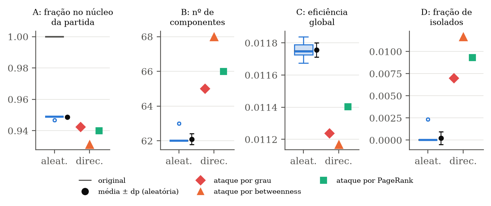

# Analisando Grafos do SNAP — G16 `comm-f2f-Resistance`

Trabalho prático de Teoria dos Grafos (UFBA — Instituto de Computação).
**Autor:** Nadson de Santana Sousa — Matrícula 224215945

## Determinação do grafo

Dada a matrícula `M = 224215945`:

| Passo | Valor |
|---|---|
| Soma dos dígitos `S` | 2+2+4+2+1+5+9+4+5 = **34** |
| Dois últimos dígitos `D` | **45** |
| `(S × (D + 1)) mod 129` | (34 × 46) mod 129 = 1564 mod 129 = **16** |

Grafo atribuído: **G16 — [comm-f2f-Resistance](https://snap.stanford.edu/data/comm-f2f-Resistance.html)**
(redes dinâmicas de interação face a face em 62 partidas do jogo *The Resistance*).

## Estrutura

```
data/processed/        dados tratados (CSV) usados nas análises
  vertices.csv           451 participantes (id, partida, participante)
  arestas_dirigidas.csv  1.241 arcos u->v (atenção e distância)
  arestas.csv            951 arestas não-direcionadas (atenção e distância)
  partidas.csv           metadados das 62 partidas
  etapas_tratamento.json evolução do grafo ao longo do tratamento
src/
  tratamento.py        dados brutos -> grafo estático tratado
  grafo.py             lista de adjacência
  algoritmos.py        BFS, DFS, Eulerianidade, Dijkstra, Bellman-Ford, Floyd-Warshall
                       (Python e numpy),
                       Tarjan (SCC e pontes/articulações), Prim, Kruskal
  metricas.py          métricas estruturais
  propriedades.py      small-world, lei de potência, centralidades, robustez e modelos
  benchmark.py         tempo real: média, desvio e IC 95% (Z ou t-Student)
  comum.py             caminhos, estilo dos gráficos e carga do grafo tratado
  parte1.py            Parte I  (python -m src.parte1)
  parte2.py            Parte II (python -m src.parte2), inclui o experimento de escala
  parte3.py            Parte III (python -m src.parte3)
  tabelas.py           tabelas LaTeX e macros do relatório a partir dos JSONs
  executar.py          executa as três partes e gera as tabelas
tests/                 testes por módulo (NetworkX usado apenas como oráculo)
results/               resultados em JSON, tabelas tab_*.tex e macros valores.tex
figures/               figuras em PDF (relatório) e PNG (README e notebook)
notebooks/analise.ipynb  reúne resultados, tabelas e figuras (não recalcula nada)
figures/               figuras do relatório
relatorio/             relatório em LaTeX (template WebMedia) e PDF
scripts/baixar_dados.sh  download do dataset original
```

## Tratamento realizado

1. **Temporal → estático:** para cada par ordenado (u, v) da mesma partida calcula-se
   a atenção `f(u, v)`, a fração dos instantes (1/3 s) em que u olha para v.
2. **Remoção do alvo LAPTOP** (não é participante) e de auto-laços.
3. **Limiar de atenção:** mantém-se u → v apenas se `f(u, v) ≥ 1/N`, sendo N o número de alvos
   possíveis de u (N−1 colegas + laptop), ou seja, se u olha para v mais do que sob atenção uniforme.
4. **Dirigido → não-direcionado:** {u, v} existe se u → v ou v → u; peso
   `w = (f(u,v) + f(v,u)) / 2` e distância `d = −ln(w)` (usada nos algoritmos ponderados).
5. **União das 62 partidas** em um único grafo (vértice `gXX_pY`). A versão dirigida é usada no Tarjan.

## Resultados principais

O relatório completo está em [`relatorio/224215945.pdf`](relatorio/224215945.pdf). Os números
abaixo vêm de `results/`; os tempos da Parte II variam a cada execução, os demais são
determinísticos (sementes fixas).


### Parte I: análise estrutural (tudo exato, sem amostragem)

| Medida | Valor |
|---|---:|
| Vértices / arestas | 451 / 951 |
| Grau mín. / máx. / médio / mediano | 1 / 7 / 4,22 / 4 |
| Densidade global / média intra-partida | 9,37×10⁻³ / 0,67 |
| Componentes (= partidas) | 62, de 5 a 8 vértices |
| Diâmetro / raio (maior componente) | 2 / 1 (diâmetro máximo entre componentes: 3) |
| Comprimento médio dos caminhos | 1,34 |
| Clusterização média / triângulos / transitividade | 0,754 / 791 / 0,676 |

### Parte II: algoritmos (grafo completo, IC 95%)

| Algoritmo | Complexidade | Média (ms) | IC 95% (ms) |
|---|---|---:|---|
| BFS | O(V+E) | 0,30 | [0,22; 0,38] |
| DFS | O(V+E) | 0,69 | [0,41; 0,97] |
| Eulerianidade | O(V+E) | 0,07 | [0,06; 0,09] |
| Dijkstra (todas as fontes) | O(V(V+E) log V) | 3,6 | [3,3; 3,9] |
| Bellman-Ford (todas as fontes) | O(V²E) | 443 | [378; 508] |
| Floyd-Warshall (Python, com poda) | O(V³) | 70 | [69; 71] (t-Student, n = 10) |
| Floyd-Warshall (numpy, sem poda) | O(V³) | 490 | [350; 630] (t-Student, n = 10) |
| Tarjan (SCC, dirigido) | O(V+E) | 0,69 | [0,64; 0,74] |
| Tarjan (pontes e articulações) | O(V+E) | 0,79 | [0,74; 0,85] |
| Prim | O(E log V) | 0,56 | [0,47; 0,65] |
| Kruskal | O(E log V) | 1,03 | [0,92; 1,15] |

- Dijkstra, Bellman-Ford e Floyd-Warshall produzem distâncias idênticas nos 2.870 pares alcançáveis.
- Floyd-Warshall vetorizado com numpy é ~7× **mais lento** que o puro: sem poda, faz sempre as
  V³ ≈ 9×10⁷ operações, enquanto a versão pura ignora intermediários inalcançáveis (cada vértice
  só alcança a própria partida).
- Tarjan: 131 SCCs (uma não-trivial por partida); apenas 3 pontes e 3 articulações em todo o grafo.
- Prim e Kruskal: floresta geradora mínima com 389 arestas (uma árvore por partida) e mesmo peso.
- **Complexidade observada** (subgrafos de 58 a 451 vértices, ajuste log-log): expoente ≈ 1
  para os algoritmos lineares; Dijkstra e Bellman-Ford de todas as fontes e Floyd-Warshall
  crescem um grau de V abaixo do pior caso, porque cada fonte só alcança a própria partida.


### Parte III: propriedades da rede

| Pergunta | Resposta |
|---|---|
| Small-world? | **Só aparentemente.** Contra um G(n,m) global, σ ≈ 301; contra um aleatório que respeita as partidas, σ ≈ 1,14 e L é o mesmo (1,34). Os caminhos curtos vêm do tamanho dos grupos (≤ 8 pessoas). |
| Lei de potência? | **Não.** A regressão log-log tem inclinação positiva (R² = 0,46); o ajuste por máxima verossimilhança discreto exato (zeta de Hurwitz) dá γ = 5,88 ± 0,38 numa cauda de só 3 valores de k, com KS = 0,13. A distribuição é subdispersa (Var(k) = 2,0 < ⟨k⟩ = 4,2), próxima de uma Poisson. |
| Robusta à remoção aleatória de 5%? | **Sim.** 95,1% dos vértices continuam no núcleo conexo da sua partida (o máximo possível é 95,1%). |
| Robusta à remoção dos 5% mais centrais? | **Sim.** Por grau, betweenness e PageRank, a fração no núcleo cai só para 94,5%, 93,3% e 94,2%: não há hubs (k ≤ 7) e quase nenhuma partida tem vértice de corte. |
| Descoberta mais interessante | A estrutura global é inteiramente explicada pela divisão em partidas; a informação está na direção das arestas (só 46,7% dos arcos são recíprocos e 13,7% dos participantes não recebem atenção acima do uniforme). |
| Extra: modelo clássico | Nenhum globalmente (BA cria hubs, ER e WS são conexos com caminhos longos); cada partida se aproxima de um Erdős–Rényi denso (p ≈ 0,67). |



## Como executar

Requisitos: Python 3.10+ (testado com Python 3.11.2 e as versões fixadas em `requirements.txt`).

```bash
python3 -m venv .venv
.venv/bin/pip install -r requirements.txt
./scripts/baixar_dados.sh            # baixa ~44 MB do SNAP e confere as contagens publicadas
.venv/bin/python -m src.tratamento   # regenera data/processed/
.venv/bin/python -m pytest           # testes
.venv/bin/python -m src.executar     # análises completas (~1 min); --rapido para teste
.venv/bin/python -m src.executar --so-figuras   # só redesenha as figuras a partir de results/
.venv/bin/python -m src.parte2       # ou apenas uma parte (parte1, parte2, parte3)
.venv/bin/python -m src.tabelas      # só regenera as tabelas do relatório a partir dos JSONs
.venv/bin/jupyter notebook notebooks/analise.ipynb   # consulta dos resultados
```

O relatório inclui as tabelas de `results/` com `\input` e os valores citados no texto
por macros (`results/valores.tex`). Assim, após uma nova execução, basta recompilar o PDF.

Os dados tratados já estão versionados; o download só é necessário para refazer o tratamento.

Para compilar o relatório:

```bash
cd relatorio && pdflatex main.tex && pdflatex main.tex
```

## Reprodutibilidade

- Sementes fixas (42) em todo sorteio: grafos aleatórios, remoções e modelos clássicos.
  Reexecutar reproduz todos os resultados, exceto os tempos da Parte II.
- Versões das dependências fixadas em `requirements.txt`.
- `scripts/verificar_dados.py` confere o download com o SNAP (62 partidas, 451 participantes,
  3.126.993 arestas temporais); `tests/` confere o tratamento e cada algoritmo próprio com o
  NetworkX (`python -m pytest`, 64 testes, um arquivo por módulo).
- Figuras gravadas sem data nos metadados e com ordem de vértices fixa: redesenhar não
  altera os arquivos versionados.

## Onde mexer

| Quero alterar... | Arquivo |
|---|---|
| leitura dos dados brutos, limiar de atenção, pesos | `src/tratamento.py` |
| estrutura de grafo (lista de adjacência) | `src/grafo.py` |
| um algoritmo da Parte II | `src/algoritmos.py` (testes em `tests/test_<família>.py`) |
| repetições, tamanhos do experimento de escala | `src/parte2.py` (`parte2`, `parte2_escala`) |
| uma métrica da Parte I | `src/metricas.py` |
| small-world, lei de potência, centralidades, robustez, modelos | `src/propriedades.py` |
| cálculo do IC 95% | `src/benchmark.py` |
| aparência de uma figura | função `figura_*` da respectiva `src/parteN.py`; cores em `src/comum.py` |
| formato de uma tabela ou valor citado no relatório | `src/tabelas.py` |
| texto do relatório | `relatorio/main.tex` |

## Referências

- S. Kumar, C. Bai, V. S. Subrahmanian, J. Leskovec. *Deception Detection in Group Video
  Conversations using Dynamic Interaction Networks*. ICWSM, 2021.
- C. Bai et al. *Predicting the Visual Focus of Attention in Multi-Person Discussion Videos*. IJCAI, 2019.
- J. Leskovec, A. Krevl. *SNAP Datasets: Stanford Large Network Dataset Collection*, 2014.
